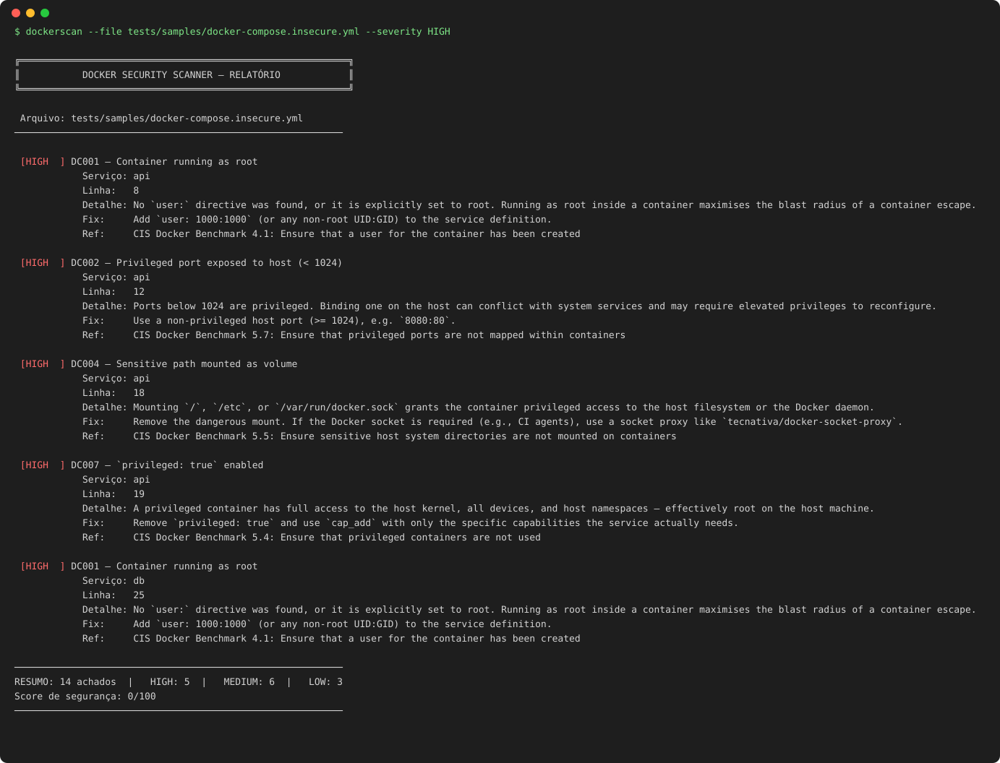

# dockerscan

[](https://github.com/NathaliaGF/docker-security-scanner/actions/workflows/ci.yml)


**English** · [Português](README.pt-BR.md)

A static security scanner for `Dockerfile` and `docker-compose.yml` files. A deterministic engine decides what is a finding. An optional AI layer (Claude) **explains** each one and drafts a **fix that is re-scanned before it is accepted**. It runs in your terminal, in CI (SARIF for GitHub code scanning, PR comments) and as an MCP tool for AI assistants.



## Why it is built this way

LLMs are good at explaining a risk and drafting a patch, and bad at being the source of truth: they miss real issues and invent fake ones. So the design splits the work:

| Layer | Job | Deterministic |
|---|---|---|
| **Rule engine** (20 rules, CIS-mapped) | Decides what is a finding, where, and how severe | yes |
| **`--explain`** | Explains the risk *in your file* and a realistic attack | no |
| **`--fix`** | Drafts a corrected file, then **re-scans it**. Accepted only if findings go down and no new rule fires | validated |
| **MCP server** | Lets any AI assistant call the scanner instead of guessing | yes |

The model never overrides the scanner. A fix that makes things worse is rejected and the file is left untouched.

## Install

```bash
pipx install "git+https://github.com/NathaliaGF/docker-security-scanner.git"            # core
pipx install "dockerscan[ai,mcp] @ git+https://github.com/NathaliaGF/docker-security-scanner.git"   # + AI and MCP
# or with Docker
docker build -t dockerscan . && docker run --rm -v "$PWD:/scan:ro" dockerscan --dir .
```

## Usage

```bash
dockerscan --file docker-compose.yml
dockerscan --dir ./my-project --severity HIGH          # recursive, skips .git / node_modules / venvs
dockerscan --dir . --output json                       # one valid JSON document, even for many files
dockerscan --dir . --output sarif > results.sarif      # GitHub code scanning
dockerscan --dir . --output markdown                   # PR comments, job summaries
dockerscan --list-rules
```

Exit code is `1` when a finding at or above `--fail-on` exists (default `HIGH`; use `--fail-on MEDIUM` or `none`). `2` means a usage or file error.

### AI features (optional)

```bash
export ANTHROPIC_API_KEY=...
dockerscan --file Dockerfile --explain --lang en       # or --lang pt
dockerscan --file Dockerfile --fix                     # shows a validated diff
dockerscan --file Dockerfile --fix --apply             # writes it
```

How `--fix` stays honest:

1. The scanner finds the issues, the model gets the file plus those findings.
2. The proposed file is scanned again. If issues remain, they are sent back for one more attempt.
3. The fix is accepted only if **findings decreased, no new rule fired, and no redaction marker leaked into the output**. Otherwise the file is not touched.

Privacy: the file content is sent to the Anthropic API. Values of credential-looking variables (`PASSWORD`, `TOKEN`, `SECRET`, `API_KEY`…) are masked as `<REDACTED>` before leaving your machine. File content is treated as untrusted data in the prompt. Pick a model with `--model` or `DOCKERSCAN_MODEL`.

Limits: the model can only fix what the 20 rules detect, and some findings need a separate file (for example a `.dockerignore`). It leaves a `# TODO` there instead of guessing.

### MCP server

```bash
dockerscan-mcp      # stdio server with tools: scan_file, scan_text, list_rules, get_rule
```

```json
{ "mcpServers": { "dockerscan": { "command": "dockerscan-mcp" } } }
```

Ask your assistant to "scan this compose file and fix what you find" and it works from real findings.

### GitHub Action

```yaml
name: Docker security
on: pull_request
permissions:
  contents: read
  security-events: write   # SARIF upload
  pull-requests: write     # PR comment
jobs:
  dockerscan:
    runs-on: ubuntu-latest
    steps:
      - uses: actions/checkout@v4
      - uses: NathaliaGF/docker-security-scanner@main
        with:
          path: .
          fail-on: HIGH
          pr-comment: "true"
```

Findings show up in the **Security → Code scanning** tab, as a job summary, and as one updating comment on the pull request. This repository scans its own `Dockerfile` with the same action in CI.

## Rules

Each rule that matches a [CIS Docker Benchmark](https://www.cisecurity.org/benchmark/docker) recommendation carries its reference in the report.

| ID | Sev | Check | CIS |
|---|---|---|---|
| DC001 | HIGH | Container runs as root | 4.1 |
| DC002 | HIGH | Privileged host port (< 1024) | 5.7 |
| DC003 | MEDIUM | `latest` tag or no tag | |
| DC004 | HIGH | Sensitive host path or Docker socket mounted | 5.5 |
| DC005 | MEDIUM | Plaintext secret in `environment` | |
| DC006 | LOW | `restart: always` without healthcheck | 4.6 |
| DC007 | HIGH | `privileged: true` | 5.4 |
| DC008 | MEDIUM | `network_mode: host` | 5.9 |
| DC009 | LOW | No CPU / memory limits | 5.10 |
| DC010 | MEDIUM | Dangerous capabilities (`SYS_ADMIN`, `ALL`…) | 5.3 |
| DF001 | HIGH | `USER root` or no `USER` | 4.1 |
| DF002 | MEDIUM | Base image `latest` or untagged | |
| DF003 | HIGH | Hardcoded credential in `ENV` / `ARG` (variable references are fine) | 4.10 |
| DF004 | MEDIUM | `apt-get install` without `--no-install-recommends` | |
| DF005 | LOW | `COPY . .` without a `.dockerignore` | |
| DF006 | MEDIUM | `curl … \| bash` | |
| DF007 | LOW | More than 3 consecutive `RUN` | |
| DF008 | MEDIUM | SSH / Telnet / RDP port exposed | |
| DF009 | HIGH | Private key or certificate copied into the image | |
| DF010 | LOW | End-of-life base image | |

Score: 100 minus 15 per HIGH, 7 per MEDIUM, 2 per LOW (floor 0), always computed on all findings regardless of `--severity`.

## Development

```bash
pip install -e ".[dev]"
ruff check . && pytest -q
python tools/make_demo_svg.py      # regenerate docs/demo.svg from a real run
```

The suite (143 tests) covers every rule with positive and negative cases, the CLI, SARIF/Markdown output, and the AI layer against a fake client (no network or key needed).

## Limitations

dockerscan is a **static configuration scanner**. It reads `Dockerfile` and `docker-compose.yml` files; it never builds or runs anything.

- **Not covered:** vulnerabilities inside image layers or installed packages (use Trivy or Grype for that), runtime behaviour, secrets baked into image layers, Kubernetes manifests, and Compose files assembled through `extends` or heavy variable interpolation.
- **Coverage:** the 20 rules cover the most common CIS Docker Benchmark misconfigurations. A clean report does not mean a hardened deployment.
- **False positives and negatives:** rules are pattern based. Some findings can be intentional (for example, mounting the Docker socket in a CI agent). Review each finding before acting on it.
- **AI features:** explanations and suggested fixes are optional and can be wrong. A suggested fix is only accepted if re-scanning the changed file no longer reports the finding and introduces no new ones, but you should still review the diff.
- **Scope:** run it only on files you own or are authorised to assess.


## Roadmap

- Kubernetes manifests (`securityContext`, `hostNetwork`, `privileged`…)
- Custom rules in YAML and inline `# dockerscan:ignore` suppressions
- Image layer and SBOM scanning (Trivy / Grype) next to configuration findings

## License

MIT, see [LICENSE](LICENSE).
