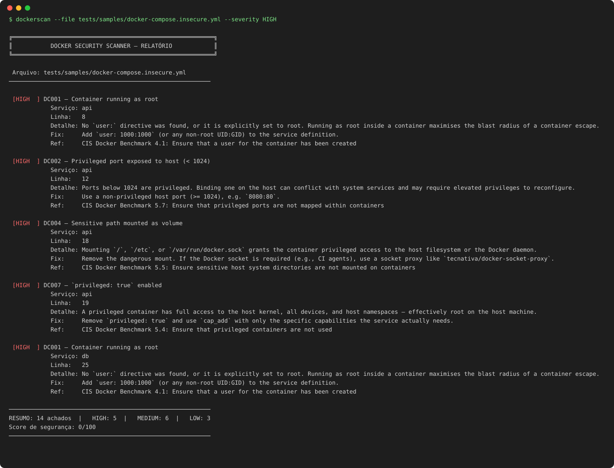

# dockerscan

[](https://github.com/NathaliaGF/docker-security-scanner/actions/workflows/ci.yml)


[English](README.md) · **Português**

Scanner estático de segurança para `Dockerfile` e `docker-compose.yml`. Um motor determinístico decide o que é achado. Uma camada opcional de IA (Claude) **explica** cada um e propõe uma **correção que é re-escaneada antes de ser aceita**. Roda no terminal, no CI (SARIF para o code scanning do GitHub, comentário em PR) e como ferramenta MCP para assistentes de IA.



## Por que foi desenhado assim

LLMs explicam bem um risco e rascunham bem um patch, mas são ruins como fonte da verdade: deixam passar problemas reais e inventam falsos. Por isso a divisão:

| Camada | Função | Determinística |
|---|---|---|
| **Motor de regras** (20 regras, mapeadas ao CIS) | Decide o que é achado, onde e com qual severidade | sim |
| **`--explain`** | Explica o risco *no seu arquivo* e um ataque realista | não |
| **`--fix`** | Propõe o arquivo corrigido e **re-escaneia**. Só aceita se os achados diminuírem e nenhuma regra nova disparar | validada |
| **Servidor MCP** | Permite a qualquer assistente de IA chamar o scanner em vez de chutar | sim |

O modelo nunca sobrescreve o scanner. Uma correção que piora o arquivo é rejeitada e o arquivo fica intacto.

## Instalação

```bash
pipx install "git+https://github.com/NathaliaGF/docker-security-scanner.git"
pipx install "dockerscan[ai,mcp] @ git+https://github.com/NathaliaGF/docker-security-scanner.git"   # + IA e MCP
# ou com Docker
docker build -t dockerscan . && docker run --rm -v "$PWD:/scan:ro" dockerscan --dir .
```

## Como usar

```bash
dockerscan --file docker-compose.yml
dockerscan --dir ./meu-projeto --severity HIGH         # recursivo, ignora .git / node_modules / venvs
dockerscan --dir . --output json                       # um único JSON válido, mesmo com vários arquivos
dockerscan --dir . --output sarif > results.sarif      # code scanning do GitHub
dockerscan --dir . --output markdown                   # comentários de PR, resumo do job
dockerscan --list-rules
```

O código de saída é `1` quando existe achado igual ou acima de `--fail-on` (padrão `HIGH`; use `--fail-on MEDIUM` ou `none`). `2` indica erro de uso ou de arquivo.

### IA (opcional)

```bash
export ANTHROPIC_API_KEY=...
dockerscan --file Dockerfile --explain --lang pt
dockerscan --file Dockerfile --fix                     # mostra um diff validado
dockerscan --file Dockerfile --fix --apply             # grava no arquivo
```

Como o `--fix` se mantém honesto:

1. O scanner acha os problemas e o modelo recebe o arquivo mais esses achados.
2. O arquivo proposto é escaneado de novo. Se sobrarem problemas, voltam ao modelo para mais uma tentativa.
3. A correção só é aceita se **os achados diminuíram, nenhuma regra nova disparou e nenhum marcador de redação vazou na saída**. Caso contrário o arquivo não é tocado.

Privacidade: o conteúdo do arquivo é enviado à API da Anthropic. Valores de variáveis que parecem credenciais (`PASSWORD`, `TOKEN`, `SECRET`, `API_KEY`…) são mascarados como `<REDACTED>` antes de sair da máquina. O arquivo é tratado como dado não confiável no prompt. Escolha o modelo com `--model` ou `DOCKERSCAN_MODEL`.

Limites: o modelo só corrige o que as 20 regras detectam, e alguns achados pedem outro arquivo (por exemplo um `.dockerignore`). Nesses casos ele deixa um `# TODO` em vez de chutar.

### Servidor MCP

```bash
dockerscan-mcp      # servidor stdio com as ferramentas: scan_file, scan_text, list_rules, get_rule
```

```json
{ "mcpServers": { "dockerscan": { "command": "dockerscan-mcp" } } }
```

### GitHub Action

```yaml
name: Docker security
on: pull_request
permissions:
  contents: read
  security-events: write   # upload do SARIF
  pull-requests: write     # comentário no PR
jobs:
  dockerscan:
    runs-on: ubuntu-latest
    steps:
      - uses: actions/checkout@v4
      - uses: NathaliaGF/docker-security-scanner@main
        with:
          path: .
          fail-on: HIGH
          pr-comment: "true"
```

Os achados aparecem em **Security → Code scanning**, no resumo do job e em um comentário único (atualizado) no pull request. Este repositório escaneia o próprio `Dockerfile` com a mesma action no CI.

---

## Checks implementados

### docker-compose.yml

| ID     | Severidade | Descrição                                                        |
|--------|------------|------------------------------------------------------------------|
| DC001  | HIGH       | Container rodando como root (sem `user:` ou `user: root`)        |
| DC002  | HIGH       | Porta privilegiada exposta no host (< 1024)                      |
| DC003  | MEDIUM     | Imagem usando tag `latest` ou sem tag                            |
| DC004  | HIGH       | Volume sensível montado (`/`, `/etc`, socket do Docker)          |
| DC005  | MEDIUM     | Segredo em texto plano em variável de ambiente                   |
| DC006  | LOW        | `restart: always` sem health check definido                      |
| DC007  | HIGH       | `privileged: true` habilitado                                    |
| DC008  | MEDIUM     | Modo de rede host (`network_mode: host`)                         |
| DC009  | LOW        | Sem limites de CPU ou memória definidos                          |
| DC010  | MEDIUM     | Capabilities Linux perigosas adicionadas (`SYS_ADMIN`, `ALL`…)  |

### Dockerfile

| ID     | Severidade | Descrição                                                        |
|--------|------------|------------------------------------------------------------------|
| DF001  | HIGH       | `USER root` explícito ou ausência de instrução `USER`            |
| DF002  | MEDIUM     | Imagem base usando tag `latest` ou sem tag                       |
| DF003  | HIGH       | Credenciais hardcoded em `ENV` ou `ARG`                          |
| DF004  | MEDIUM     | `apt-get install` sem `--no-install-recommends`                  |
| DF005  | LOW        | `COPY . .` sem arquivo `.dockerignore`                           |
| DF006  | MEDIUM     | Script remoto executado via pipe (`curl \| bash`)                 |
| DF007  | LOW        | Mais de 3 instruções `RUN` consecutivas                          |
| DF008  | MEDIUM     | Porta sensível exposta via `EXPOSE` (22, 23, 3389)               |
| DF009  | HIGH       | Chave privada ou certificado TLS copiado para dentro da imagem   |
| DF010  | LOW        | Imagem base sem suporte (`ubuntu:16.04`, `debian:8`…)            |

---

## Score de segurança

Cada análise gera uma pontuação de **0 a 100**:

| Severidade | Dedução por achado |
|------------|--------------------|
| HIGH       | −15 pontos         |
| MEDIUM     | −7 pontos          |
| LOW        | −2 pontos          |

O score é calculado sobre a lista completa de achados, independente do filtro `--severity` aplicado na exibição.

---

## Formato de saída

O relatório de terminal está na demo acima (cada achado traz a referência CIS quando existe).

### Saída JSON (`--output json`)

```json
{
  "file": "docker-compose.yml",
  "score": 62,
  "total_findings": 3,
  "findings": [
    {
      "id": "DC007",
      "severity": "HIGH",
      "description": "`privileged: true` habilitado",
      "detail": "Um container privilegiado tem acesso total ao kernel do host...",
      "fix": "Remova `privileged: true` e use `cap_add` apenas com as capabilities necessárias.",
      "service": "api",
      "line": 12
    }
  ],
  "summary": {
    "HIGH": 1,
    "MEDIUM": 1,
    "LOW": 1
  }
}
```

---

## Rodando os testes

```bash
pip install -e ".[dev]"
ruff check . && pytest -q
```

A suíte contém **143 testes**: casos positivos e negativos por regra, CLI, saídas SARIF/Markdown e a camada de IA contra um cliente falso (sem rede nem chave).

---

## Roadmap

- Manifests Kubernetes (`securityContext`, `hostNetwork`, `privileged`…)
- Regras customizadas em YAML e supressão inline `# dockerscan:ignore`
- Scan de camadas de imagem e SBOM (Trivy / Grype) junto dos achados de configuração

---

## Licença

MIT — consulte o arquivo [LICENSE](LICENSE) para detalhes.
